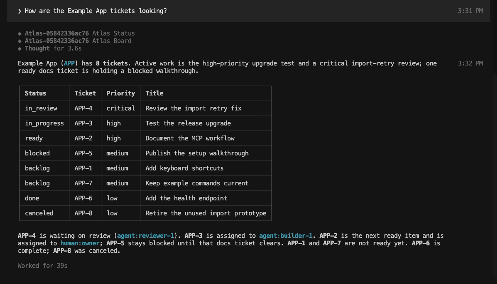
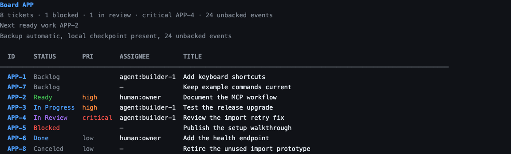
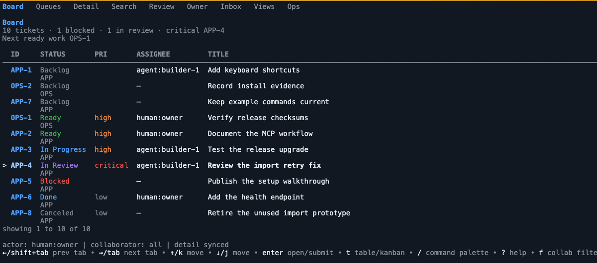
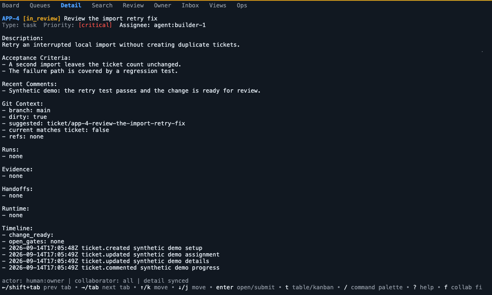
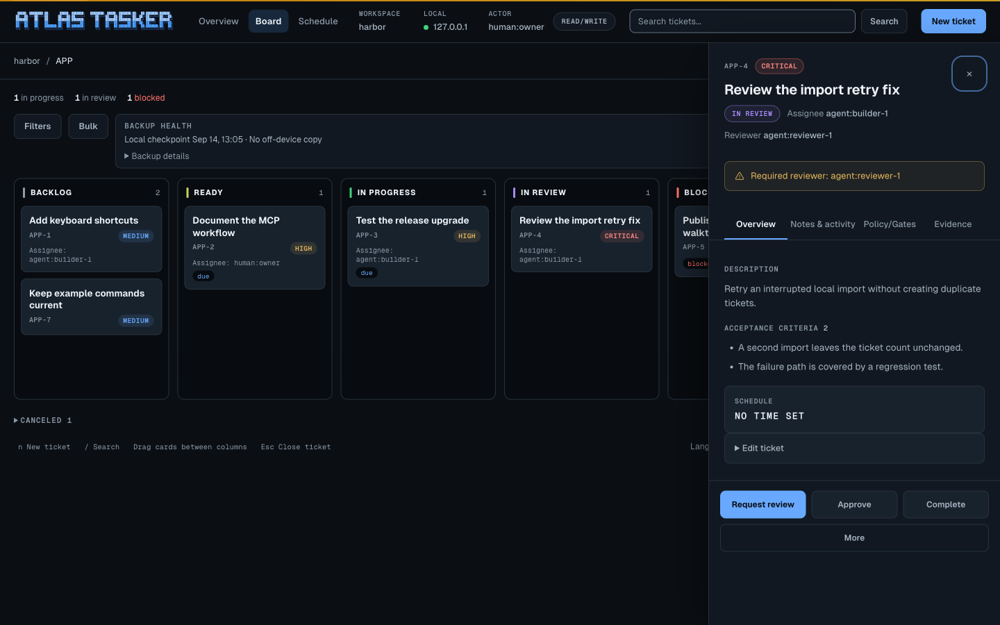
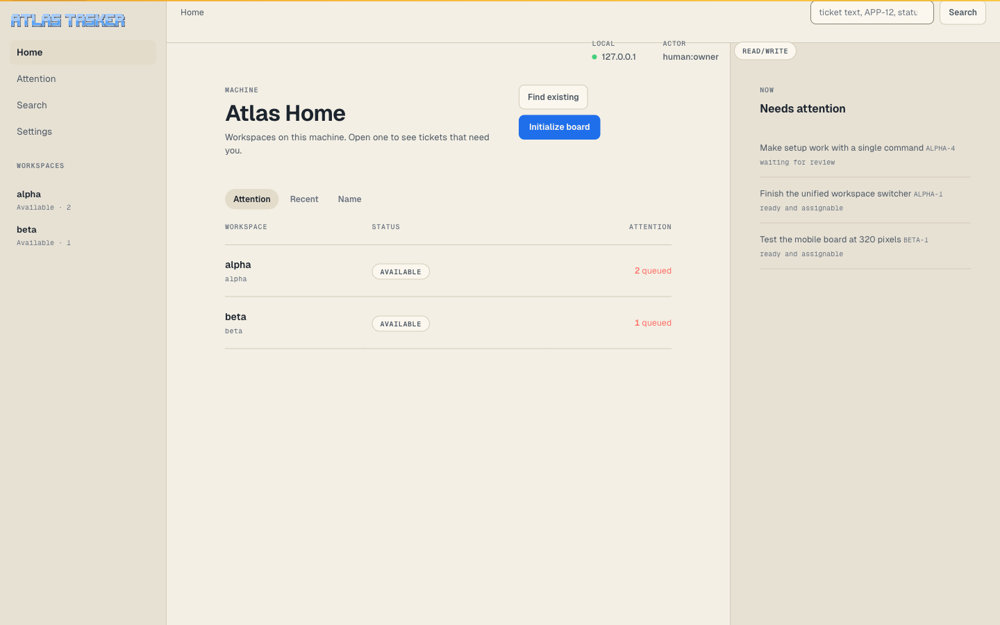
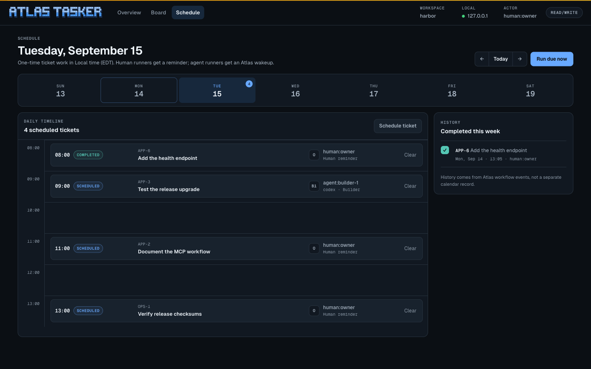
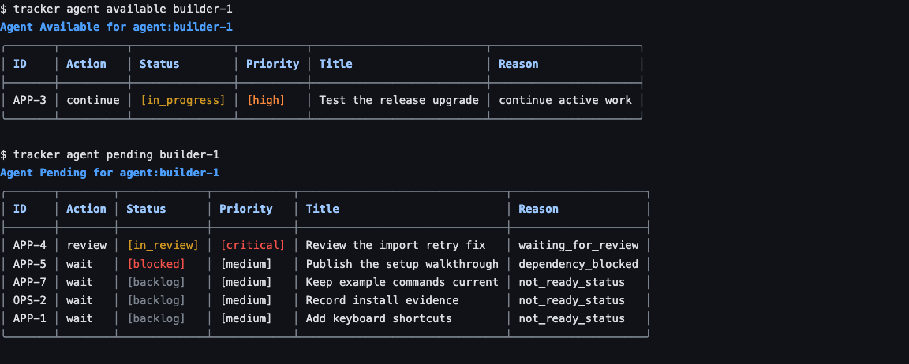

# Atlas Tasker


**Jira for your terminal, built for AI coding agents.**

[](https://github.com/myrrazor/atlas-tasker/actions/workflows/ci.yml)
[](https://github.com/myrrazor/atlas-tasker/releases)
[](LICENSE)

Atlas Tasker is a local-first issue tracker that lives in your repo. Tickets, dependencies, review gates, and audit history are markdown files plus a rebuildable SQLite index — no hosted account. Coding agents (Claude Code, Codex, Cursor, OpenClaw, Grok, anything that speaks MCP) claim work, block on each other, attach evidence, and hand off for review on the same board.

> **New in v1.17.1:** Atlas Home sessions survive server restarts; live boards retain typed drafts, saved views, and active drags during concurrent updates. [Release notes](https://github.com/myrrazor/atlas-tasker/releases/tag/v1.17.1) · [Home and workspaces](docs/guides/home-and-workspaces.md).

## Get started

Install Atlas Tasker. Requires `curl`, `tar`, and [GitHub CLI](https://cli.github.com/) (`gh`); provenance verification works without signing in to GitHub.

```bash
curl -fsSL https://raw.githubusercontent.com/myrrazor/atlas-tasker/main/scripts/install.sh | sh
```

Inside your project, run:

```bash
tracker init
```

Atlas adds guidance and the workflow MCP connection for detected coding agents. Restart your agent and accept its project trust or MCP approval prompt. Then ask:

```text
What's the current status of this project?
```

```text
Add a high-priority ticket to improve onboarding and assign it to me.
```

You can also ask your agent to “Initialize Atlas Tasker in this project.” To manage the same tickets yourself, run **`tracker`** to open Atlas Home and its Kanban board.

The installer places the binary; `tracker init` connects the chosen project. See [installation](docs/installation.md) for destinations and PATH, or [client compatibility](docs/v1.16-client-compatibility.md) for tested clients and their approval steps.

### A real agent session

[](https://atlastasker.com/#agent-demo)

Ask for status, add a ticket, and see the board update. [Watch the walkthrough](https://atlastasker.com/#agent-demo) · [Transcript](docs/examples/grok-video-transcript.md).

### Same board, many agents

Give each agent its own tickets on a shared board. Assignees, leases, and review gates keep the work coordinated.

[See the shared-board walkthrough](https://atlastasker.com/#shared-board) · [Setup and transcript](docs/examples/multi-agent-board.md).

## Install

The one-liner above is the normal path: latest **published** GitHub release, SHA-256, GitHub build attestation via a local bundle (`gh` required; no GitHub login). Default destination `/usr/local/bin` (`BIN_DIR` to change it, `VERSION` to pin a tag).

Optional, with Go 1.26.6 or newer:

```bash
go install github.com/myrrazor/atlas-tasker/cmd/tracker@latest
```

Optional, from this source (an unstamped tagged checkout can report its module tag; other checkouts report `dev+<commit>` with VCS metadata or `dev`; none proves hosted provenance; commands below assume that binary):

```bash
git clone https://github.com/myrrazor/atlas-tasker && cd atlas-tasker
go build -o tracker ./cmd/tracker
./tracker version --json
```

`tracker init` writes identity, `projects/` and `.tracker/`, local checkpoints, and Atlas-managed entries named **`atlas-tasker`** (`mcp serve --global --tool-profile workflow`) for clients it actually finds. Detected agents are configured without a picker. If no detected client gets an `AGENTS.md`, init writes a generic guide and worker skill so agents such as Meta Muse have local board instructions to read. The init result points to `AGENTS.md`; a host must actually read and follow it for automatic board presentation. `--integrations` (or bare `tracker integrations install`) is the older TTY picker. Opt out with `--no-agents` / `--skip-integrations`, `--no-backup`, `--no-register`, `--no-open`, or `--git-mode private|unmanaged`.

Mutation commands resolve `--actor`, then `TRACKER_ACTOR`, then `actor.default`, and exit 2 before writing if none is set. There is no silent `human:owner` fallback.

Default `tracker board` is a polished table. `--style kanban` is optional cards. `--style chat` makes an ANSI board for compatible chats; `--style html` makes a self-contained, expandable board fragment for hosts that render inline HTML; `--style markdown` formats the board for Markdown chats such as Grok Bot. The MCP board tool also offers an inline widget in MCP Apps hosts. The browser stays Kanban, and `--json` is the machine contract. See the [chat board guide](docs/guides/chat-board.md).



Prefer a full-screen view? `tracker tui` — board, queues, ticket detail, search. The Board tab uses the same table as `tracker board`.





Every ticket is markdown under `projects/`, every change is an append-only event in `.tracker/`, and the SQLite file is a disposable index. If it goes missing, the next command rebuilds it; `tracker doctor --repair` does it on demand.

## Atlas Home

`tracker` starts or reuses one machine-wide Home service on `127.0.0.1:7432`. It works outside a repo. If something else owns that port, Atlas fails instead of silently moving.

Home opens with a one-time claim in the URL fragment, then `POST /session/claim` for an HttpOnly loopback cookie. That cookie is essential to the local app, not a marketing tracker. The site at [atlastasker.com](https://atlastasker.com) sets none.

Home can create a board under Atlas boards, attach an existing workspace, or authorize an existing directory after showing the exact path and purpose. Kanban covers create, edit, assign, claim, review, and delete (files and history are retained; there is no restore). Home init does **not** write client MCP files — still `tracker init` for that. [Browser management](docs/v1.16-browser-management.md).

`tracker web serve --open` remains the single-workspace board. Prefer Home for new setups.







## Agents

Register agents, assign tickets, wire dependencies. Atlas does not launch Claude, Codex, or Grok for you.

```bash
tracker agent create builder-1 --name "Builder" --provider claude --capability go \
  --actor human:owner --reason "register"
tracker ticket assign APP-2 agent:builder-1 --actor human:owner --reason "agent work"
tracker ticket link APP-2 --blocked-by APP-1 --actor human:owner --reason "needs the API first"
```



Init writes the worker skill **and**, unless `--no-agents`, the `atlas-tasker` MCP entry. Status is `written`, `pending_client_restart`, or `unverified` from the actual file — never “connected” just because a config exists. Guidance, native skill listing, configured MCP, and a live session are four different facts. [Compatibility matrix](docs/v1.16-client-compatibility.md).

**[AGENTS.md](AGENTS.md) is the file to hand an agent.** Claude Code picks it up via `CLAUDE.md`.

Team presets (`solo`, `pair`, `swarm`, `crossfire`) still apply with `tracker team apply`. Existing agents are never overwritten. [Team presets](docs/guides/team-presets.md).

`tracker update` replaces the binary only. Re-run `tracker init` (or the documented setup/install) **inside each workspace** to refresh managed skills.

## Local checkpoints, then an explicit remote

Tickets already live in Git with your repo. Atlas also keeps **local checkpoints** of Atlas-owned records under machine state. `tracker init` starts that replica unless `--no-backup`. A remote is separate and never inferred from `origin`. A successful push is not verified until Atlas fetches the remote commit. [Setup and backup](docs/guides/setup-and-backup.md).

## Uninstall the software, keep the boards

```bash
tracker uninstall          # preview
tracker uninstall --yes    # apply; boards stay
```

[Uninstall](docs/guides/uninstall.md).

## Network endpoints and credentials

Audited from the source at this commit (`internal/update`, `internal/service`, `internal/app`, `internal/web`, `internal/cli`). Atlas Tasker has **no telemetry**, no hosted backend, and **no API keys of its own**. The Grok plugin's MCP server (`tracker mcp serve`, workflow profile) makes no outbound internet calls unless you configure a webhook.

| Endpoint | Called by | When |
|---|---|---|
| `https://api.github.com/repos/myrrazor/atlas-tasker/releases/latest` | `tracker update` | Only when you run an update, to find the latest release tag |
| `https://github.com/myrrazor/atlas-tasker/releases/download/<tag>/<asset>` and `.../checksums.txt` | `tracker update` | Only during an update; the archive is SHA-256-checked and verified with `gh attestation verify` |
| `RELEASE_BASE_URL` (your own mirror, `https://` only) | `tracker update` | Only if you set it; loopback `http://` also needs `ALLOW_INSECURE_RELEASE_BASE_URL=1` |
| Your `notifications.webhook_url` | event notifier (CLI and MCP mutations) | Only if you configure it in workspace settings; JSON `POST` of the event, with a timeout and bounded retries |
| GitHub via the `gh` CLI (PR create/view/checks, attestation verify) | `tracker gh …`, change/checks sync, `tracker update` | Only those commands; uses your existing `gh` login |
| Your Git remote: pushes `refs/atlas-tasker/sync/<workspaceID>`, fetches `+refs/atlas-tasker/sync/*:refs/remotes/atlas-sync/*` (`refs/remotes/atlas-sync/*` is only the local tracking namespace) | `tracker sync …` | Only after you add a sync remote explicitly |
| `http://127.0.0.1:7432/` (loopback only) | Atlas Home / `tracker web`, MCP board URL, health probe `/healthz` | Local browser board; binds to localhost, never a public interface |

Credentials and environment variables:

- **No Atlas key or token exists.** Nothing to paste into the plugin or `.mcp.json`.
- **GitHub:** `tracker gh` and sync reuse the `gh` CLI's own login and your Git credential helper; Atlas never reads, stores, or prints those tokens. Installing and verifying releases works without a GitHub login.
- **Browser session:** Atlas Home keeps its local session token in the workspace state directory (excluded from Git) and rotates it; it never leaves the machine.
- **Webhook URL:** stored in workspace settings; treat it as a secret if it embeds one.
- Environment variables read: `TRACKER_ACTOR` (default actor), `HOME` (also via the Go home-directory lookup), `PATH`, `XDG_STATE_HOME` (state directory for sessions, receipts and backup state, `setup/paths.go` and `service/backup_state.go`), `CLAUDE_CONFIG_DIR` and `CODEX_HOME` (client detection), `NO_COLOR`, `COLUMNS`, and for `tracker update` only `RELEASE_BASE_URL`, `ALLOW_INSECURE_RELEASE_BASE_URL`, `VERIFY_ATTESTATIONS`. None of them is a credential.
- Passed through to child processes, not read by Atlas: local checkpoint Git runs with a scrubbed environment whose allowlist (`gitSafeEnv`, `service/checkpoint_git.go`) keeps only `PATH`, `HOME`, `USER`, `LOGNAME`, `XDG_CONFIG_HOME`, `XDG_CACHE_HOME`, `XDG_STATE_HOME`, `SSH_AUTH_SOCK`, `SSH_AGENT_PID`, `LANG`, `LC_ALL`, `TZ` and `TMPDIR`. Sync Git, `gh` and the Atlas Home child process inherit your full environment (plus `GIT_TERMINAL_PROMPT=0` for Git), so any `GH_TOKEN` or SSH agent you already use reaches those tools; Atlas itself never reads or logs them.

## Docs

Start at the [docs landing page](docs/README.md), or jump to [installation](docs/installation.md), [getting started](docs/getting-started.md), [v1.16 migration](docs/migration-v1.16.md), [Home](docs/guides/home-and-workspaces.md), [agent integrations](docs/guides/agent-integrations.md), [MCP](docs/guides/mcp-for-agents.md), [compatibility](docs/v1.16-client-compatibility.md), [browser management](docs/v1.16-browser-management.md), [command reference](docs/command-reference.md), or [troubleshooting](docs/troubleshooting.md).

What Atlas does **not** claim: [security limitations](docs/security-limitations.md).

## Status

Atlas Tasker **v1.17.1** improves Home, live-board, schedule, and large-board stability. The installer selects the latest published release. [CHANGELOG.md](CHANGELOG.md) lists the changes. See verification results on the [GitHub release page](https://github.com/myrrazor/atlas-tasker/releases/latest).

`v1.9.0` was the first stable release. Found something broken? [Open an issue](https://github.com/myrrazor/atlas-tasker/issues) — and please don't paste private keys, tokens, or full `.tracker` archives into it. Security reports go through [private vulnerability reporting](SECURITY.md).

## Contributing

PRs welcome — read [CONTRIBUTING.md](CONTRIBUTING.md). The project is MIT licensed.
